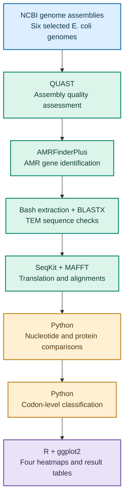
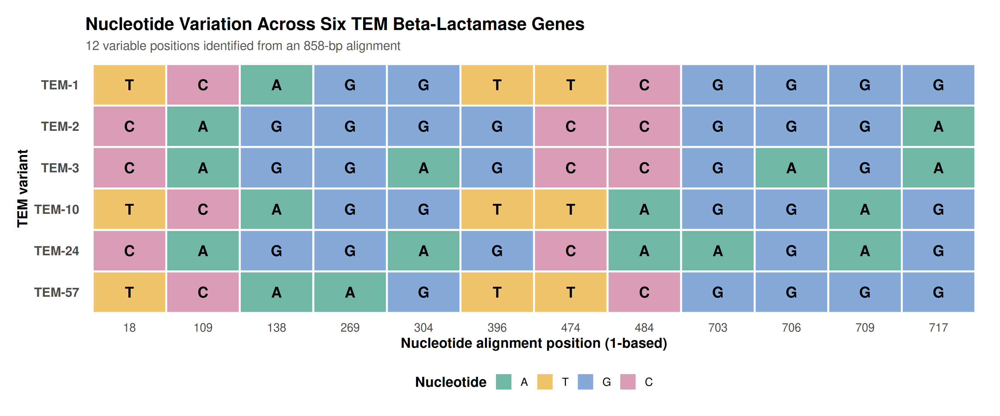
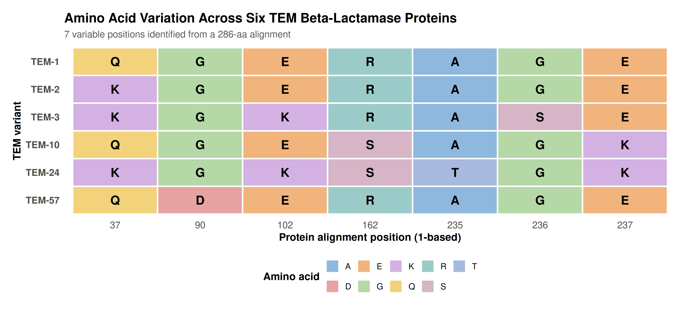
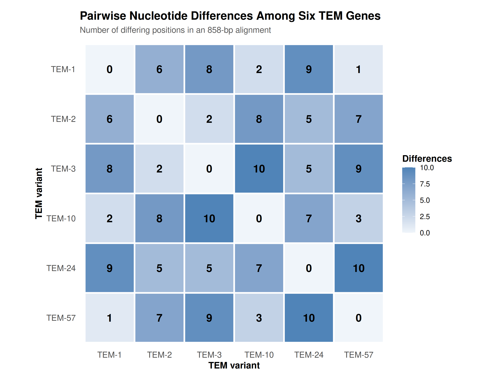
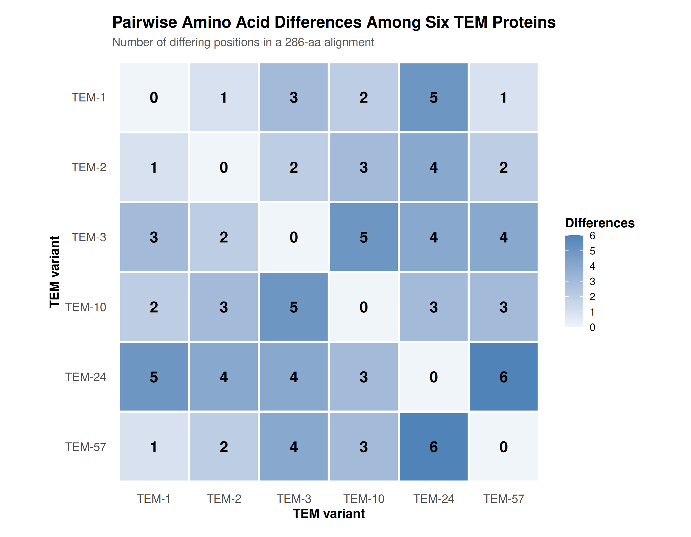

<div align="center">

# 🧬 TEM β-Lactamase Comparative Genomics
### Exploring nucleotide and protein variation in *Escherichia coli*

**An independent bioinformatics project on antimicrobial resistance**


**6 TEM variants · 12 variable nucleotide positions · 7 variable amino acid positions · 15 pairwise comparisons**

</div>

---

## 📖 1. Project overview

Antimicrobial resistance makes bacterial infections increasingly difficult to treat. One important mechanism involves beta-lactamases, enzymes that can hydrolyse the beta-lactam ring of susceptible antibiotics, including amoxicillin. TEM beta-lactamases belong to the **Ambler class A serine beta-lactamase family**, and certain TEM variants exhibit differences in antibiotic substrate specificity associated with changes in their amino acid sequences [6, 8, 9].

My interest in antimicrobial resistance developed during my undergraduate Medical Laboratory Science research, which investigated bacterial isolates from urine samples of pregnant women with urinary tract infections and their antimicrobial susceptibility patterns. This experience raised questions about the genetic mechanisms underlying differences in bacterial antibiotic resistance.

To explore these questions computationally, I investigated six TEM beta-lactamase variants associated with *Escherichia coli*: **TEM-1, TEM-2, TEM-3, TEM-10, TEM-24 and TEM-57**. Published experimental evidence concerning TEM-mediated beta-lactam resistance, particularly amoxicillin hydrolysis, provided the biological motivation for comparing their nucleotide and protein sequences.

Using publicly available genome assemblies, I identified and verified the selected TEM genes, examined nucleotide, amino acid and codon-level variation, and interpreted the findings alongside published research. This was a **comparative sequence analysis**, not an experimental assessment of antibiotic susceptibility.

**Jump to:** [Question and objectives](#-2-research-question-and-objectives) · [Dataset](#-3-dataset) · [Methods](#-4-methodology) · [Results](#-5-results) · [Interpretation](#-6-biological-interpretation-and-limitations) · [Reproducibility](#-7-reproducibility) · [References](#-8-references-and-acknowledgements)

---

## 🎯 2. Research question and objectives

**Research question:** What nucleotide, amino acid and codon-level variations exist among six selected TEM beta-lactamase variants in *Escherichia coli*, and how do these variations relate to published experimental evidence concerning TEM-mediated amoxicillin resistance?

I set out to:

1. Retrieve six selected *E. coli* genome assemblies and assess their quality.
2. Identify, extract and independently verify the selected TEM beta-lactamase coding sequences.
3. Compare nucleotide and translated protein sequences to identify variable positions.
4. Quantify pairwise differences among the six variants.
5. Distinguish synonymous from nonsynonymous codon variation.
6. Interpret the findings using published experimental evidence while recognising the limitations of sequence-based analysis.

---

## 🧫 3. Dataset

I used the following NCBI genome assembly accessions, recorded during the assembly verification stage:

| Selected TEM variant | NCBI assembly accession |
|:--|:--|
| TEM-1 | `GCF_000010765.1` |
| TEM-2 | `GCA_032298435.1` |
| TEM-3 | `GCA_012578525.1` |
| TEM-10 | `GCA_026378375.1` |
| TEM-24 | `GCA_059152815.1` |
| TEM-57 | `GCA_061231245.1` |

One selected TEM coding sequence from each assembly was included in the final comparison. All six sequences were **858 nucleotides long**, corresponding to **286 amino acids** each. Assembly verification and gene extraction records are available in [`metadata/`](metadata/).

---

## 🔬 4. Methodology

### Analysis workflow



### Genome retrieval and gene identification

I downloaded six selected *E. coli* genome assemblies from NCBI and assessed their quality using **QUAST**. I then used **AMRFinderPlus** to identify antimicrobial resistance genes, focusing on TEM beta-lactamases.

To independently verify the extracted TEM sequences without searching the much larger NCBI protein database, I constructed a **targeted local protein reference database**. I extracted **233 TEM reference protein sequences** from the AMRFinderPlus `AMRProt.fa` dataset, including references for the six selected variants. These sequences were assembled into a FASTA file and formatted into a searchable protein database using **BLAST+ `makeblastdb`**.

I subsequently used **BLASTX** to compare the extracted TEM nucleotide sequences against this local database. The six sequences matched their expected TEM reference proteins, providing additional verification alongside AMRFinderPlus identification.

Following verification, I reviewed published experimental studies describing TEM beta-lactamase classification, substrate specificity and amoxicillin hydrolysis [6, 8, 9]. This established the biological rationale for investigating sequence differences among related enzymes with a broadly similar beta-lactam resistance mechanism.

### Sequence alignment and comparisons

I used **MAFFT** to align the six TEM nucleotide sequences and **Python** to identify variable positions and calculate pairwise differences. Having identified nucleotide variation, I wanted to determine whether these differences also affected the encoded proteins.

I therefore used **SeqKit** to translate the coding sequences into amino acids, followed by a second MAFFT alignment at the protein level. Python was used to identify variable amino acid positions and quantify differences among the six variants.

Comparing the nucleotide and protein results allowed me to investigate which sequence differences changed the encoded amino acids. Published experimental studies were subsequently consulted to assess the known functional relevance of particular TEM substitutions, especially their effects on substrate specificity and beta-lactam hydrolysis [8, 9].

### Codon analysis and visualisation

Using **Python**, I examined the nucleotide sequences in groups of three bases to classify variable codon positions as synonymous or nonsynonymous. Synonymous variation does not change the encoded amino acid, whereas nonsynonymous variation produces an amino acid difference.

I then used **R and ggplot2** to generate four heatmaps illustrating nucleotide variation, amino acid variation and pairwise sequence differences.

---

## 📊 5. Results

### At a glance

| Measure | Finding |
|:--|--:|
| TEM variants compared | **6** |
| Length of each coding sequence | **858 bp** |
| Length of each translated protein | **286 amino acids** |
| Variable nucleotide positions | **12** |
| Conserved nucleotide positions | **846** |
| Variable amino acid positions | **7** |
| Conserved amino acid positions | **279** |
| Variable codon positions | **12** |
| Codon positions with synonymous-only variation | **5** |
| Codon positions with nonsynonymous variation | **7** |
| Unique pairwise comparisons | **15** |

### 5.1 Where do the sequences vary?

The nucleotide alignment identified **12 variable positions** across the six TEM sequences. At the protein level, **seven positions** varied: **37, 90, 102, 162, 235, 236 and 237**.

This distinction is important because nucleotide substitutions do not always change the encoded amino acid. Amino acid variation warrants further investigation because certain substitutions in TEM enzymes have been associated with altered biochemical properties [8, 9].

**Figure 1 — Nucleotide variation**



**Figure 2 — Amino acid variation**



### 5.2 How different are the variants from one another?

All **15 unique pairs** of TEM variants were compared. Pairwise differences ranged from **1 to 10 nucleotides** and **1 to 6 amino acids** among the selected sequences.

**Figure 3 — Pairwise nucleotide differences**



**Figure 4 — Pairwise protein differences**



The underlying numerical results are available in [`results/variants/`](results/variants/).

### 5.3 What happened at the codon level?

Of the **12 variable codon positions**, five showed synonymous-only variation (**6, 46, 132, 158 and 239**), while seven showed nonsynonymous variation (**37, 90, 102, 162, 235, 236 and 237**).

For example, `TTT` and `TTC` both encode phenylalanine, demonstrating how nucleotide variation can occur without changing the amino acid. In contrast, nonsynonymous differences alter the encoded protein and may have functional consequences depending on the substitution.

These positions represent variation across the selected sequences, not separate evolutionary mutation events.

---

## 🧠 6. Biological interpretation and limitations

### 6.1 Biological significance of sequence variation

The six TEM variants exhibited substantial nucleotide and protein sequence conservation, alongside variation at specific positions. Codon analysis demonstrated that some nucleotide differences were synonymous, whereas others altered the encoded amino acids.

This distinction is biologically relevant because TEM beta-lactamase activity depends on protein structure, catalytic function and interactions with antibiotic substrates. Published studies have shown that certain amino acid substitutions can influence enzyme activity and substrate specificity [8, 9].

However, **not every amino acid substitution produces a measurable functional change**. The significance of each difference depends on its identity, location and biochemical effects. Therefore, sequence variation alone cannot establish whether one TEM variant confers greater amoxicillin resistance than another.

### 6.2 Comparison with published experimental studies

Published experimental studies provide important context for interpreting variation among the selected TEM enzymes.

| TEM variant(s) | Published biological evidence | Relevance to this project |
|:--|:--|:--|
| **TEM-1 and TEM-2** | Well-characterised penicillinases. TEM-2 differs from TEM-1 by Q39K under conventional TEM numbering, without a major change in substrate profile [9, 10]. | Demonstrates that amino acid variation does not necessarily alter antibiotic activity. |
| **TEM-3 and TEM-24** | Extended-spectrum TEM beta-lactamases investigated in experimental studies, including amoxicillin-related biochemical and susceptibility analyses [8]. | Illustrates how related TEM enzymes can exhibit different substrate profiles. |
| **TEM-10** | An extended-spectrum TEM enzyme associated with substitutions including R164S and E240K in published characterisations [9, 10]. | Supports investigating substitutions associated with altered substrate specificity, without assuming a particular amoxicillin effect. |
| **TEM-57** | Bonnet et al. (1999) described a Gly92Asp substitution that did not necessarily alter intrinsic catalytic activity [8]. | Demonstrates that an amino acid difference does not automatically indicate increased resistance. |

These studies establish that TEM sequence variation can have different biological consequences. Some substitutions are associated with altered substrate recognition or enzyme activity, while others may have little measurable effect.

Importantly, the positions reported in this project are **protein alignment coordinates**, not automatically equivalent to standard Ambler residue numbering. Directly linking an observed substitution to a published functional mutation requires verification of both its amino acid identity and numbering.

The published experiments therefore provide biological context for the computational findings, rather than direct evidence of the functional effects of the exact sequences analysed here.

### 6.3 Interpretation and limitations

The findings demonstrate that related TEM beta-lactamase variants can retain highly similar sequences while differing at specific nucleotide and amino acid positions. Comparing these differences with published experimental studies provides a basis for investigating their potential relevance to antimicrobial resistance.

However, the following limitations should be considered:

- **Dataset size:** Only six selected TEM coding sequences were analysed, one from each genome assembly.
- **No susceptibility testing:** Amoxicillin minimum inhibitory concentrations (MICs) were not measured.
- **No functional assays:** Enzyme activity, catalytic efficiency and substrate affinity were not experimentally assessed.
- **Residue numbering:** Alignment positions require verification against standard TEM numbering before assigning literature-reported functional effects.
- **Additional resistance mechanisms:** Gene expression, bacterial permeability, efflux and other resistance determinants may influence observed resistance phenotypes.

Consequently, this project provides a **computational characterisation of TEM sequence variation**, supported by published biological evidence, rather than experimental confirmation of altered amoxicillin resistance.

The project also strengthened my ability to connect laboratory-based antimicrobial resistance questions with computational sequence analysis and scientific literature.

---

## 💻 7. Reproducibility

### Tools

| Tool | Role in this project |
|:--|:--|
| Linux / Bash | File organisation and workflow scripts |
| NCBI | Public genome assemblies |
| QUAST | Assembly quality assessment |
| AMRFinderPlus | AMR gene screening |
| BLASTX | Protein similarity verification |
| BLAST+ `makeblastdb` | Local TEM protein database construction |
| SeqKit | Sequence processing and translation |
| MAFFT | Nucleotide and protein alignments |
| Python | Variation, pairwise and codon analyses |
| R / ggplot2 | Results visualisation |

### Repository layout

```text
Ecoli_AMR_Project/
├── README.md
├── .gitignore
├── metadata/                 # Assembly and TEM verification records
├── reference/                # TEM reference sequences
├── scripts/                  # Bash, Python and R scripts
└── results/
    ├── alignments/           # Nucleotide and protein alignments
    ├── amrfinder/            # AMRFinderPlus reports
    ├── blastx/               # BLASTX reports
    ├── figures/              # Four heatmaps (PNG and PDF)
    ├── proteins/             # Translated protein sequences
    ├── quast/                # Assembly quality reports
    ├── tem_genes/            # Extracted TEM coding sequences
    └── variants/             # Comparison and codon tables
```

The original genome assembly downloads are stored locally rather than committed to the repository. Their accessions are recorded in [`metadata/assembly_verification.tsv`](metadata/assembly_verification.tsv).

Analysis scripts are available in [`scripts/`](scripts/), while alignments, comparison tables and figures are organised under [`results/`](results/).

For instructions on software setup, input data retrieval, sequence comparisons, codon analysis and figure generation, see the [Reproducibility Guide](REPRODUCIBILITY.md).

The Conda software dependencies are documented in [`environment.yml`](environment.yml).

---

## 📚 8. References and acknowledgements

### References

1. Feldgarden M. et al. (2021). AMRFinderPlus and the Reference Gene Catalog facilitate examination of the genomic links among antimicrobial resistance, stress response, and virulence. *Scientific Reports*, 11, 12728. [DOI](https://doi.org/10.1038/s41598-021-91456-0).
2. Gurevich A. et al. (2013). QUAST: quality assessment tool for genome assemblies. *Bioinformatics*, 29, 1072–1075. [DOI](https://doi.org/10.1093/bioinformatics/btt086).
3. Katoh K. and Standley D.M. (2013). MAFFT multiple sequence alignment software version 7: improvements in performance and usability. *Molecular Biology and Evolution*, 30, 772–780. [DOI](https://doi.org/10.1093/molbev/mst010).
4. Camacho C. et al. (2009). BLAST+: architecture and applications. *BMC Bioinformatics*, 10, 421. [DOI](https://doi.org/10.1186/1471-2105-10-421).
5. Shen W. et al. (2016). SeqKit: a cross-platform and ultrafast toolkit for FASTA/Q file manipulation. *PLOS ONE*, 11, e0163962. [DOI](https://doi.org/10.1371/journal.pone.0163962).
6. Bradford P.A. (2001). Extended-spectrum beta-lactamases in the 21st century: characterization, epidemiology, and detection of this important resistance threat. *Clinical Microbiology Reviews*, 14, 933–951. [DOI](https://doi.org/10.1128/CMR.14.4.933-951.2001).
7. [National Center for Biotechnology Information (NCBI)](https://www.ncbi.nlm.nih.gov/).
8. Bonnet R., De Champs C., Sirot D., Chanal C., Labia R. and Sirot J. (1999). Diversity of TEM mutants in *Proteus mirabilis*. *Antimicrobial Agents and Chemotherapy*, 43, 2671–2677. [DOI](https://doi.org/10.1128/AAC.43.11.2671).
9. Natural evolution of TEM-1 β-lactamase. *FEMS Microbiology Reviews* (2010). [Article](https://academic.oup.com/femsre/article/34/6/1015/592234).
10. Rawat D. and Nair D. (2010). Extended-spectrum β-lactamases in Gram Negative Bacteria. *Journal of Global Infectious Diseases*, 2(3), 263–274. [DOI](https://doi.org/10.4103/0974-777X.68531).

### Acknowledgements

I developed this project independently while building my skills in bioinformatics and microbial genomics. It draws on my undergraduate experience in Medical Laboratory Science and antimicrobial resistance research, alongside my later training in computational analysis. I am grateful to the researchers and developers who make genome data, reference resources and bioinformatics software publicly available.

---

<div align="center">

**Microbial genomics · Antimicrobial resistance · Comparative sequence analysis · Reproducible research**

</div>
