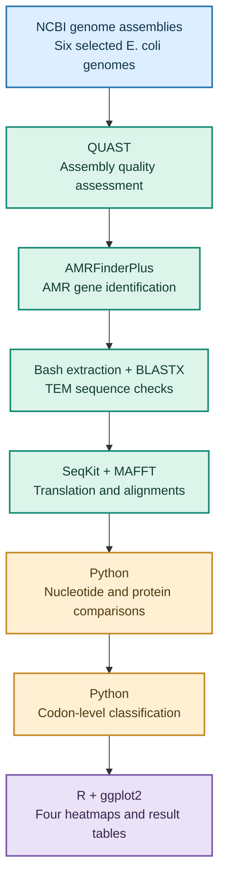

<div align="center">

# 🧬 TEM β-Lactamase Comparative Genomics
### Exploring nucleotide and protein variation in *Escherichia coli*

**An independent bioinformatics project on antimicrobial resistance**


**6 TEM variants · 12 variable nucleotide positions · 7 variable amino acid positions · 15 pairwise comparisons**

</div>

---

## 📖 1. Project overview

Antimicrobial resistance makes bacterial infections more difficult to treat. Some bacteria resist beta-lactam antibiotics, including amoxicillin, by producing enzymes called beta-lactamases. **TEM enzymes belong to the class A serine beta-lactamase family**. They can hydrolyse the beta-lactam ring of susceptible antibiotics, including amoxicillin, preventing the drug from effectively inhibiting bacterial cell-wall synthesis. Different TEM variants can have differences in their DNA and protein sequences, some of which have been associated with altered antibiotic substrate profiles in published experiments [6, 8, 9].

My interest in antimicrobial resistance started during my undergraduate studies in Medical Laboratory Science. My research looked at bacterial isolates from urine samples of pregnant women with urinary tract infections and their antimicrobial susceptibility patterns. That work made me curious about what happens at the genetic level: why might one bacterial isolate resist an antibiotic while another does not?

As I developed my skills in Linux, Python, R and bioinformatics, I wanted to explore this question using sequence data. For this project, I selected six TEM beta-lactamase variants associated with *Escherichia coli*: **TEM-1, TEM-2, TEM-3, TEM-10, TEM-24 and TEM-57**. After identifying and verifying the selected TEM sequences, I consulted published experimental studies to establish the enzymes' relevance to beta-lactam resistance, particularly amoxicillin hydrolysis. That literature-based rationale motivated the subsequent comparisons; it was not an experimental measurement performed in this project [8, 9].

I used publicly available genome assemblies to identify and extract TEM genes, compare their nucleotide and protein sequences, examine codon differences and visualise the results. This is a **sequence-comparison study**, not an experimental test of antibiotic resistance.

**Jump to:** [Question and objectives](#-2-research-question-and-objectives) · [Dataset](#-3-dataset) · [Methods](#-4-methodology) · [Results](#-5-results) · [Interpretation](#-6-biological-interpretation-and-limitations) · [Reproducibility](#-7-reproducibility) · [References](#-8-references-and-acknowledgements)

---

## 🎯 2. Research question and objectives

**Research question:** What nucleotide, amino acid and codon-level variations exist among six selected TEM beta-lactamase variants in Escherichia coli, and how do these variations relate to published experimental evidence concerning TEM-mediated amoxicillin resistance?


I set out to:

1. Retrieve six selected *E. coli* genome assemblies and assess their quality.
2. Identify, extract and check the TEM beta-lactamase coding sequences.
3. Align the nucleotide sequences and their translated proteins.
4. Identify variable positions and compare every pair of variants.
5. Distinguish synonymous from nonsynonymous codon differences.
6. Present the findings clearly and discuss what they do—and do not—show about resistance.

---

## 🧫 3. Dataset

I used the following NCBI genome assembly accessions, recorded during the assembly verification stage:

| Selected TEM variant | NCBI assembly accession |
|:--|:--|
| TEM-1 | `GCF_000010765.1` |
| TEM-2 | `GCA_032298435.1` |
| TEM-3 | `GCA_012578525.1` |
| TEM-10 | `GCA_026378375.1` |
| TEM-24 | `GCA_059152815.1` |
| TEM-57 | `GCA_061231245.1` |

One selected TEM coding sequence from each assembly was included in the final comparison. All six sequences were **858 nucleotides long**, corresponding to **286 amino acids** each. Assembly checks, gene verification and extraction records are kept in [`metadata/`](metadata/).

---

## 🔬 4. Methodology

### Analysis workflow



### Genome retrieval and gene identification

I downloaded the selected assemblies from NCBI and used **QUAST** to examine assembly quality. I then used **AMRFinderPlus** to screen for antimicrobial resistance genes, focusing on TEM beta-lactamases. I extracted the selected TEM coding sequences and used **BLASTX** against a local protein reference database as an additional sequence-similarity check.

Following variant identification and sequence verification, I reviewed published experimental literature on TEM beta-lactamases and their activity against amoxicillin and other beta-lactam antibiotics. This established the **biological motivation** for comparing the selected variants before interpreting their sequence differences [8, 9]. Published measurements were used as external context, not as experimental results generated by this workflow.

### Sequence alignment and comparisons

I aligned the six nucleotide sequences using **MAFFT**. I also translated the coding sequences using **SeqKit** and aligned the resulting proteins. I wrote Python scripts to identify variable positions and calculate the differences between all **15 unique pairs** of sequences at both nucleotide and protein levels.

### Codon analysis and visualisation

I examined the nucleotide sequences three bases at a time to see whether differences changed the encoded amino acid. A **synonymous** difference changes a codon without changing the amino acid; a **nonsynonymous** difference changes the amino acid. I then used **R and ggplot2** to create four heatmaps from the results.

---

## 📊 5. Results

### At a glance

| Measure | Finding |
|:--|--:|
| TEM variants compared | **6** |
| Length of each coding sequence | **858 bp** |
| Length of each translated protein | **286 amino acids** |
| Variable nucleotide positions | **12** |
| Conserved nucleotide positions | **846** |
| Variable amino acid positions | **7** |
| Conserved amino acid positions | **279** |
| Variable codon positions | **12** |
| Codon positions with synonymous-only variation | **5** |
| Codon positions with nonsynonymous variation | **7** |
| Unique pairwise comparisons | **15** |

### 5.1 Where do the sequences vary?

The nucleotide alignment showed **12 variable positions** across the six sequences. At the protein level, **seven positions** varied: **37, 90, 102, 162, 235, 236 and 237**. This difference matters because a change in DNA does not always change the amino acid produced. Published work on TEM beta-lactamases shows why amino acid changes warrant closer examination: particular substitutions can influence substrate recognition or catalytic behaviour, although a sequence difference does not by itself demonstrate a functional effect [8, 9].

**Figure 1 — Nucleotide variation**


**Figure 2 — Amino acid variation**


### 5.2 How different are the variants from one another?

I compared every variant with the other five. The pairwise heatmaps show the number of positions that differ between each pair. Among the selected sequences, pairwise differences ranged from **1 to 10 nucleotides** and **1 to 6 amino acids**.

**Figure 3 — Pairwise nucleotide differences**


**Figure 4 — Pairwise protein differences**


The numerical tables behind these figures are available in [`results/variants/`](results/variants/).

### 5.3 What happened at the codon level?

Of the **12 variable codon positions**, five showed only synonymous variation (**6, 46, 132, 158 and 239**) and seven showed nonsynonymous variation (**37, 90, 102, 162, 235, 236 and 237**).

For example, at codon position 6, some sequences had `TTT` and others had `TTC`. Both encode **phenylalanine (F)**, so this is a synonymous difference. The seven nonsynonymous-variable codon positions corresponded to the seven variable positions seen in the protein alignment. Because nonsynonymous changes alter the encoded protein, they are particularly relevant when comparing sequence findings with experimentally characterised TEM substitutions [8, 9]; however, their effects cannot be inferred from codon classification alone.

These are **variable positions across the selected sequences**, not counts of separate evolutionary mutation events.

---

## 🧠 6. Biological interpretation and limitations

The six TEM sequences were very similar overall, but they were not identical. Some DNA differences did not change the protein sequence, while others changed the amino acid at particular positions. Looking at both nucleotide and protein sequences helped me understand that distinction more clearly.

**Why amoxicillin matters to this comparison:** TEM enzymes are class A beta-lactamases that can inactivate susceptible beta-lactam antibiotics by hydrolysing their beta-lactam ring. The published experimental literature provided the rationale for investigating these six variants rather than treating their sequence differences as purely descriptive. In particular, Bonnet *et al.* (1999) measured amoxicillin hydrolysis kinetics for TEM-1, TEM-2, TEM-3, TEM-24 and TEM-57, as well as resistance phenotypes in studied bacterial strains [8]. This is external experimental evidence for the biological relevance of those enzymes; the same paper does **not** establish corresponding TEM-10-specific amoxicillin measurements.

**Connecting protein variation to experimental findings:** Published studies show that individual TEM amino acid substitutions can affect enzyme properties and beta-lactam substrate profiles [8, 9]. Bonnet *et al.* reported a Gly92Asp difference in TEM-57 relative to TEM-1, but importantly noted that this change did **not necessarily alter intrinsic catalytic activity** [8]. This illustrates why a detected nonsynonymous substitution should not automatically be labelled resistance-enhancing. Likewise, findings for expanded-spectrum cephalosporins should not be assumed to represent equivalent changes in amoxicillin hydrolysis. The seven variable protein positions reported here are **alignment coordinates**, and no position-specific functional effect is assigned without validated correspondence to the residue numbering and substitutions reported in experimental studies.

TEM beta-lactamases can contribute to resistance against beta-lactam antibiotics. However, **sequence differences alone cannot tell us how resistant an isolate is to amoxicillin**. The effect of an amino acid change depends on the enzyme and the specific substitution, and bacterial resistance also depends on factors such as gene expression and other resistance mechanisms. Published functional studies provide context, but direct experimental measurements would be needed to test the effects of the specific sequences analysed here.

There are also limits to this analysis. I compared only **six selected sequences**, with one selected TEM coding sequence per assembly. I did not perform antimicrobial susceptibility testing, measure minimum inhibitory concentrations (MICs), test enzyme activity or reconstruct the evolutionary history of the variants. The reported protein positions are positions in the **286-amino-acid aligned sequences**; they should not automatically be treated as conventional Ambler residue numbers.

For me, this project was a way to connect my earlier laboratory experience in antimicrobial resistance with the sequence-based analysis skills I have been learning.

---

## 💻 7. Reproducibility

### Tools

| Tool | Role in this project |
|:--|:--|
| Linux / Bash | File organisation and workflow scripts |
| NCBI | Public genome assemblies |
| QUAST | Assembly quality assessment |
| AMRFinderPlus | AMR gene screening |
| BLASTX | Protein similarity checks |
| SeqKit | Sequence processing and translation |
| MAFFT | Nucleotide and protein alignments |
| Python | Variation, pairwise and codon analyses |
| R / ggplot2 | Results visualisation |

### Repository layout

```text
Ecoli_AMR_Project/
├── README.md
├── .gitignore
├── metadata/                 # Assembly and TEM verification records
├── reference/                # TEM reference sequences
├── scripts/                  # Bash, Python and R scripts
└── results/
    ├── alignments/           # Nucleotide and protein alignments
    ├── amrfinder/            # AMRFinderPlus reports
    ├── blastx/               # BLASTX reports
    ├── figures/              # Four heatmaps (PNG and PDF)
    ├── proteins/             # Translated protein sequences
    ├── quast/                # Assembly quality reports
    ├── tem_genes/            # Extracted TEM coding sequences
    └── variants/             # Comparison and codon tables
```

The original genome assembly downloads are kept locally rather than committed to the repository. Their accessions are recorded in [`metadata/assembly_verification.tsv`](metadata/assembly_verification.tsv) so they can be retrieved again.

The analysis scripts are available in [`scripts/`](scripts/), including the four R visualisation scripts and the Python codon-analysis script. The generated alignments, tables and figures are included under [`results/`](results/). Reproducing the workflow requires the relevant software, reference data and compatible tool versions.

For detailed instructions on setting up the software environment, obtaining the input data, reproducing the nucleotide, protein and codon-level analyses, and regenerating the four heatmaps, see the [Reproducibility Guide](REPRODUCIBILITY.md).

The required Conda dependencies are documented in [environment.yml](environment.yml).

---

## 📚 8. References and acknowledgements

### References

1. Feldgarden M. et al. (2021). AMRFinderPlus and the Reference Gene Catalog facilitate examination of the genomic links among antimicrobial resistance, stress response, and virulence. *Scientific Reports*, 11, 12728. [DOI](https://doi.org/10.1038/s41598-021-91456-0).
2. Gurevich A. et al. (2013). QUAST: quality assessment tool for genome assemblies. *Bioinformatics*, 29, 1072–1075. [DOI](https://doi.org/10.1093/bioinformatics/btt086).
3. Katoh K. and Standley D.M. (2013). MAFFT multiple sequence alignment software version 7: improvements in performance and usability. *Molecular Biology and Evolution*, 30, 772–780. [DOI](https://doi.org/10.1093/molbev/mst010).
4. Camacho C. et al. (2009). BLAST+: architecture and applications. *BMC Bioinformatics*, 10, 421. [DOI](https://doi.org/10.1186/1471-2105-10-421).
5. Shen W. et al. (2016). SeqKit: a cross-platform and ultrafast toolkit for FASTA/Q file manipulation. *PLOS ONE*, 11, e0163962. [DOI](https://doi.org/10.1371/journal.pone.0163962).
6. Bradford P.A. (2001). Extended-spectrum beta-lactamases in the 21st century: characterization, epidemiology, and detection of this important resistance threat. *Clinical Microbiology Reviews*, 14, 933–951. [DOI](https://doi.org/10.1128/CMR.14.4.933-951.2001).
7. [National Center for Biotechnology Information (NCBI)](https://www.ncbi.nlm.nih.gov/).
8. Bonnet R., De Champs C., Sirot D., Chanal C., Labia R. and Sirot J. (1999). Diversity of TEM mutants in *Proteus mirabilis*. *Antimicrobial Agents and Chemotherapy*, 43, 2671–2677. [DOI](https://doi.org/10.1128/AAC.43.11.2671).
9. [Natural evolution of TEM-1 β-lactamase](https://academic.oup.com/femsre/article/34/6/1015/592234). *FEMS Microbiology Reviews* (2010). Review of TEM sequence evolution, substitutions and functional consequences.

### Acknowledgements

I developed this project independently while building my skills in bioinformatics and microbial genomics. It draws on my undergraduate experience in Medical Laboratory Science and antimicrobial resistance research, alongside my later training in computational analysis. I am grateful to the researchers and developers who make genome data, reference resources and bioinformatics software publicly available.

---

<div align="center">

**Microbial genomics · Antimicrobial resistance · Comparative sequence analysis · Reproducible research**

</div>
