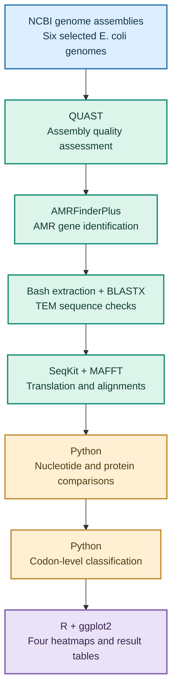

<div align="center">

# 🧬 TEM β-Lactamase Comparative Genomics
### Exploring nucleotide and protein variation in *Escherichia coli*

**An independent bioinformatics project on antimicrobial resistance**


**6 TEM variants · 12 variable nucleotide positions · 7 variable amino acid positions · 15 pairwise comparisons**

</div>

---

## 📖 1. Project overview

Antimicrobial resistance makes bacterial infections more difficult to treat. Some bacteria resist beta-lactam antibiotics, including amoxicillin, by producing enzymes called beta-lactamases. **TEM enzymes belong to the class A serine beta-lactamase family**. They can hydrolyse the beta-lactam ring of susceptible antibiotics, including amoxicillin, preventing the drug from effectively inhibiting bacterial cell-wall synthesis. Different TEM variants can have differences in their DNA and protein sequences, some of which have been associated with altered antibiotic substrate profiles in published experiments [6, 8, 9].

My interest in antimicrobial resistance started during my undergraduate studies in Medical Laboratory Science. My research looked at bacterial isolates from urine samples of pregnant women with urinary tract infections and their antimicrobial susceptibility patterns. That work made me curious about what happens at the genetic level: why might one bacterial isolate resist an antibiotic while another does not?

As I developed my skills in Linux, Python, R and bioinformatics, I wanted to explore this question using sequence data. For this project, I selected six TEM beta-lactamase variants associated with *Escherichia coli*: **TEM-1, TEM-2, TEM-3, TEM-10, TEM-24 and TEM-57**. After identifying and verifying the selected TEM sequences, I consulted published experimental studies to establish the enzymes' relevance to beta-lactam resistance, particularly amoxicillin hydrolysis. That literature-based rationale motivated the subsequent comparisons; it was not an experimental measurement performed in this project [8, 9].

I used publicly available genome assemblies to identify and extract TEM genes, compare their nucleotide and protein sequences, examine codon differences and visualise the results. This is a **sequence-comparison study**, not an experimental test of antibiotic resistance.

**Jump to:** [Question and objectives](#-2-research-question-and-objectives) · [Dataset](#-3-dataset) · [Methods](#-4-methodology) · [Results](#-5-results) · [Interpretation](#-6-biological-interpretation-and-limitations) · [Reproducibility](#-7-reproducibility) · [References](#-8-references-and-acknowledgements)

---

## 🎯 2. Research question and objectives

**Research question:** What nucleotide, amino acid and codon-level variations exist among six selected TEM beta-lactamase variants in Escherichia coli, and how do these variations relate to published experimental evidence concerning TEM-mediated amoxicillin resistance?


I set out to:

1. Retrieve six selected *E. coli* genome assemblies and assess their quality.
2. Identify, extract and check the TEM beta-lactamase coding sequences.
3. Align the nucleotide sequences and their translated proteins.
4. Identify variable positions and compare every pair of variants.
5. Distinguish synonymous from nonsynonymous codon differences.
6. Present the findings clearly and discuss what they do—and do not—show about resistance.

---

## 🧫 3. Dataset

I used the following NCBI genome assembly accessions, recorded during the assembly verification stage:

| Selected TEM variant | NCBI assembly accession |
|:--|:--|
| TEM-1 | `GCF_000010765.1` |
| TEM-2 | `GCA_032298435.1` |
| TEM-3 | `GCA_012578525.1` |
| TEM-10 | `GCA_026378375.1` |
| TEM-24 | `GCA_059152815.1` |
| TEM-57 | `GCA_061231245.1` |

One selected TEM coding sequence from each assembly was included in the final comparison. All six sequences were **858 nucleotides long**, corresponding to **286 amino acids** each. Assembly checks, gene verification and extraction records are kept in [`metadata/`](metadata/).

---

## 🔬 4. Methodology

### Analysis workflow



### Genome retrieval and gene identification

I downloaded the six selected *Escherichia coli* genome assemblies from NCBI and used **QUAST** to assess assembly quality. I then used **AMRFinderPlus** to screen the assemblies for antimicrobial resistance genes, focusing on TEM beta-lactamases.

To support independent verification of the identified TEM sequences, I built a **local protein reference database** rather than searching against the much larger NCBI protein database. The purpose was to create a smaller, targeted reference resource that would make sequence similarity searches more focused, manageable and computationally efficient.

I assembled the reference protein sequences into a local FASTA dataset and prepared it for sequence similarity searching using **BLAST+**. I then used **BLASTX** to compare the extracted TEM coding sequences against this locally constructed protein database. This provided an additional sequence-level check alongside the initial AMRFinderPlus identification.

Following variant identification and sequence verification, I reviewed published experimental studies to establish the biological relevance of the selected TEM enzymes, particularly their reported activity against amoxicillin and other beta-lactam antibiotics. This literature review helped justify proceeding with the comparative nucleotide, protein and codon-level analyses.

Published experimental findings were used to interpret the biological significance of the sequence differences, rather than being presented as experimental measurements generated by this project.

Following the identification of the selected TEM beta-lactamase genes using **AMRFinderPlus** and subsequent sequence verification, I consulted published scientific literature to understand their biological functions and relevance to antimicrobial resistance. Previous studies established that TEM beta-lactamases belong to the **Ambler class A serine beta-lactamase family**, whose enzymes can hydrolyse the beta-lactam ring of susceptible antibiotics, including amoxicillin, thereby reducing their antibacterial activity [6, 8, 9].

This evidence provided the biological motivation for the comparative analysis. Although the selected TEM variants belong to the same enzyme family and share a broadly similar beta-lactam hydrolysis mechanism, their nucleotide and amino acid sequences are not necessarily identical. I therefore investigated **the extent of nucleotide, protein and codon-level variation among the six TEM variants**, with particular interest in understanding how the observed differences relate to published experimental findings concerning amoxicillin resistance.

The project was designed to identify and characterise sequence variation rather than directly measure antibiotic susceptibility or enzyme activity. Published experimental evidence was used to provide biological context for interpreting the computational findings.

### Sequence alignment and comparisons

Following the identification and verification of the six TEM beta-lactamase coding sequences, I used **MAFFT** to perform multiple sequence alignment at the nucleotide level. This allowed corresponding nucleotide positions to be compared across the six variants. I subsequently used **Python** to examine the aligned sequences, identify variable nucleotide positions and quantify the differences between each pair of variants.

After identifying nucleotide-level variation, I wanted to investigate whether these differences also resulted in changes to the encoded proteins. This was important because changes in a DNA sequence do not necessarily produce changes in the amino acid sequence, and amino acid substitutions can sometimes influence enzyme structure, substrate recognition and catalytic activity.

To investigate this, I used **SeqKit** to translate the six TEM coding sequences into their corresponding amino acid sequences. I then performed a second multiple sequence alignment using **MAFFT**, this time at the protein level. Using Python, I examined the aligned protein sequences to identify variable amino acid positions and determine which variants differed from one another. This allowed me to compare the nucleotide-level findings with the corresponding protein-level variation.

Having identified differences at both nucleotide and protein levels, I proceeded to **codon-level analysis** to understand the relationship between the two. Using Python, I examined the nucleotide sequences in groups of three bases (codons) and determined whether the observed nucleotide differences were synonymous, producing no change in the encoded amino acid, or nonsynonymous, resulting in an amino acid difference.

Finally, I consulted published experimental studies to investigate the biological significance of amino acid substitutions in TEM beta-lactamases, particularly their reported effects on enzyme activity, substrate specificity and amoxicillin hydrolysis [8, 9]. This literature-based interpretation helped connect the computational findings to established antimicrobial resistance mechanisms.

Importantly, the computational analysis identified sequence differences, while the published experimental studies provided evidence about the possible functional relevance of particular substitutions. The project did not directly measure enzyme activity or antibiotic susceptibility.

### Codon analysis and visualisation

I examined the nucleotide sequences three bases at a time to see whether differences changed the encoded amino acid. A **synonymous** difference changes a codon without changing the amino acid; a **nonsynonymous** difference changes the amino acid. I then used **R and ggplot2** to create four heatmaps from the results.

---

## 📊 5. Results

### At a glance

| Measure | Finding |
|:--|--:|
| TEM variants compared | **6** |
| Length of each coding sequence | **858 bp** |
| Length of each translated protein | **286 amino acids** |
| Variable nucleotide positions | **12** |
| Conserved nucleotide positions | **846** |
| Variable amino acid positions | **7** |
| Conserved amino acid positions | **279** |
| Variable codon positions | **12** |
| Codon positions with synonymous-only variation | **5** |
| Codon positions with nonsynonymous variation | **7** |
| Unique pairwise comparisons | **15** |

### 5.1 Where do the sequences vary?

The nucleotide alignment showed **12 variable positions** across the six sequences. At the protein level, **seven positions** varied: **37, 90, 102, 162, 235, 236 and 237**. This difference matters because a change in DNA does not always change the amino acid produced. Published work on TEM beta-lactamases shows why amino acid changes warrant closer examination: particular substitutions can influence substrate recognition or catalytic behaviour, although a sequence difference does not by itself demonstrate a functional effect [8, 9].

**Figure 1 — Nucleotide variation**


**Figure 2 — Amino acid variation**


### 5.2 How different are the variants from one another?

I compared every variant with the other five. The pairwise heatmaps show the number of positions that differ between each pair. Among the selected sequences, pairwise differences ranged from **1 to 10 nucleotides** and **1 to 6 amino acids**.

**Figure 3 — Pairwise nucleotide differences**


**Figure 4 — Pairwise protein differences**


The numerical tables behind these figures are available in [`results/variants/`](results/variants/).

### 5.3 What happened at the codon level?

Of the **12 variable codon positions**, five showed only synonymous variation (**6, 46, 132, 158 and 239**) and seven showed nonsynonymous variation (**37, 90, 102, 162, 235, 236 and 237**).

For example, at codon position 6, some sequences had `TTT` and others had `TTC`. Both encode **phenylalanine (F)**, so this is a synonymous difference. The seven nonsynonymous-variable codon positions corresponded to the seven variable positions seen in the protein alignment. Because nonsynonymous changes alter the encoded protein, they are particularly relevant when comparing sequence findings with experimentally characterised TEM substitutions [8, 9]; however, their effects cannot be inferred from codon classification alone.

These are **variable positions across the selected sequences**, not counts of separate evolutionary mutation events.

---

## 🧠 6. Biological interpretation and limitations

### 6.1 Connecting sequence variation to amoxicillin resistance

The comparative analysis revealed that the six selected TEM beta-lactamase variants were highly conserved at both nucleotide and protein levels, despite exhibiting variation at specific positions.
The nucleotide alignment identified **12 variable positions**, while the protein alignment revealed **seven variable amino acid positions**. Subsequent codon-level analysis showed that five variable codon positions exhibited synonymous-only variation, whereas seven exhibited nonsynonymous variation.
These findings are biologically relevant because previous experimental studies have demonstrated that certain amino acid substitutions in TEM beta-lactamases can influence enzyme activity and antibiotic substrate specificity [8, 9].

However, not all amino acid substitutions produce measurable functional changes. The biological importance of a substitution depends on its identity, location and effects on the enzyme.
The following discussion therefore considers the observed sequence differences alongside published experimental evidence, particularly findings relevant to amoxicillin hydrolysis and TEM beta-lactamase activity.

### 6.2 Nucleotide variation and its consequences

Multiple sequence alignment revealed **12 variable nucleotide positions** across the six TEM coding sequences, with the remaining **846 positions conserved**.
Although nucleotide variation indicates differences in the DNA sequences, not every nucleotide substitution changes the encoded protein. This observation motivated the translation and comparison of the corresponding amino acid sequences.

The protein alignment identified **seven variable amino acid positions: 37, 90, 102, 162, 235, 236 and 237**.
These findings demonstrate that some of the nucleotide differences were associated with differences in the encoded amino acid sequences.
The seven positions are reported using the coordinates of the protein alignment generated in this project. They should not be interpreted directly as standard Ambler residue numbers without verifying the correspondence between the numbering systems.

### 6.3 Synonymous and nonsynonymous variation

To understand the relationship between nucleotide and protein-level differences, I performed codon-level analysis.
Of the **12 variable codon positions**, five showed synonymous-only variation, while seven showed nonsynonymous variation.
Synonymous substitutions change the nucleotide sequence without changing the encoded amino acid. For example, the codons `TTT` and `TTC` both encode phenylalanine.
Nonsynonymous substitutions change the encoded amino acid and may influence protein properties, depending on the location and nature of the substitution.

This distinction was particularly relevant to the project because TEM beta-lactamases are enzymes whose activity depends on their three-dimensional structure, catalytic residues and interactions with antibiotic substrates.
However, identifying a nonsynonymous substitution does not automatically establish that it changes enzyme activity or increases antibiotic resistance.

### 6.4 Relationship to published experimental studies

To investigate the possible biological relevance of the observed protein variation, I examined published studies describing experimentally characterised TEM beta-lactamase variants.

**TEM-1 and TEM-2**

TEM-1 and TEM-2 are well-characterised penicillinases. TEM-2 differs from TEM-1 by the Q39K substitution under conventional TEM residue numbering. Published evidence indicates that this substitution does not substantially change the enzyme's substrate profile [9, 10].

This provides an example of how an amino acid substitution may distinguish related TEM enzymes without necessarily producing a major change in antibiotic substrate specificity.

**TEM-3 and TEM-24**

TEM-3 and TEM-24 have been characterised as extended-spectrum beta-lactamases (ESBLs). Unlike the original TEM penicillinases, extended-spectrum TEM variants can exhibit enhanced activity against certain expanded-spectrum cephalosporins.

Bonnet et al. (1999) investigated TEM variants, including TEM-3 and TEM-24, in a study of amoxicillin-resistant *Proteus mirabilis* isolates. The researchers reported biochemical and antimicrobial susceptibility findings that help establish the biological relevance of these enzymes [8].

These observations demonstrate that TEM variants can differ in their antibiotic substrate profiles. However, enhanced activity against expanded-spectrum cephalosporins should not automatically be interpreted as increased amoxicillin hydrolysis.

**TEM-10**

Published studies identify TEM-10 as an extended-spectrum TEM beta-lactamase associated with the R164S and E240K substitutions under conventional TEM numbering [9, 10].

These substitutions are among those investigated in studies of TEM enzyme substrate specificity and extended-spectrum activity.

Their functional relevance supports examining protein-level differences among TEM variants. However, conclusions about TEM-10-specific amoxicillin hydrolysis require evidence from studies that directly assessed that substrate.

**TEM-57**

Bonnet et al. (1999) characterised TEM-57 as a penicillinase related to TEM-1 and reported the Gly92Asp substitution.

The authors observed that this substitution could contribute to a difference in the enzyme's isoelectric point but did not necessarily alter its intrinsic catalytic activity [8].

This finding is particularly important because it demonstrates that an amino acid substitution may influence one biochemical property without necessarily producing a corresponding change in antibiotic hydrolysis.

### 6.5 What the findings suggest

The comparative analysis demonstrates that the six selected TEM variants share substantial nucleotide and amino acid sequence conservation while exhibiting variation at specific positions.
The published literature provides evidence that certain TEM amino acid substitutions can influence enzyme activity, substrate recognition and antibiotic resistance profiles [8–10].
Together, these observations support the biological relevance of examining nucleotide and protein-level variation among related TEM enzymes.

However, the specific functional effects of the seven variable amino acid positions identified in this project cannot be established from sequence comparison alone.
To determine whether an observed substitution corresponds to a previously characterised functional mutation, its amino acid identity and position must first be verified against the appropriate reference sequence and conventional TEM residue numbering.

Therefore, the findings should be interpreted as a computational characterisation of sequence variation supported by published biological evidence, rather than direct experimental confirmation of altered amoxicillin resistance.

### 6.6 Study limitations

Several limitations should be considered when interpreting the findings.

- **Limited dataset:** The analysis included six selected TEM coding sequences, with one selected sequence from each genome assembly.
- **No experimental susceptibility testing:** Minimum inhibitory concentrations (MICs) for amoxicillin were not measured.
- **No enzyme activity measurements:** The study did not directly assess beta-lactam hydrolysis rates, catalytic efficiency or substrate affinity.
- **Protein numbering:** The seven variable amino acid positions were identified using alignment coordinates and require verified correspondence to standard TEM residue numbering before direct comparison with specific literature-reported substitutions.
- **Other resistance mechanisms:** Bacterial resistance may also be influenced by gene expression, permeability, efflux and additional resistance determinants.
- **Functional interpretation:** Published experimental findings provide biological context but do not establish the effects of the exact sequences examined in this study.

Despite these limitations, the project demonstrates a reproducible computational approach for investigating variation among antimicrobial resistance genes and connecting sequence-level findings with established experimental research.

For me, the project provided an opportunity to connect my earlier laboratory experience in antimicrobial resistance with the computational skills I have developed in Linux, Bash, Python, R and microbial genomics.


---

## 💻 7. Reproducibility

### Tools

| Tool | Role in this project |
|:--|:--|
| Linux / Bash | File organisation and workflow scripts |
| NCBI | Public genome assemblies |
| QUAST | Assembly quality assessment |
| AMRFinderPlus | AMR gene screening |
| BLASTX | Protein similarity checks |
| SeqKit | Sequence processing and translation |
| MAFFT | Nucleotide and protein alignments |
| Python | Variation, pairwise and codon analyses |
| R / ggplot2 | Results visualisation |

### Repository layout

```text
Ecoli_AMR_Project/
├── README.md
├── .gitignore
├── metadata/                 # Assembly and TEM verification records
├── reference/                # TEM reference sequences
├── scripts/                  # Bash, Python and R scripts
└── results/
    ├── alignments/           # Nucleotide and protein alignments
    ├── amrfinder/            # AMRFinderPlus reports
    ├── blastx/               # BLASTX reports
    ├── figures/              # Four heatmaps (PNG and PDF)
    ├── proteins/             # Translated protein sequences
    ├── quast/                # Assembly quality reports
    ├── tem_genes/            # Extracted TEM coding sequences
    └── variants/             # Comparison and codon tables
```

The original genome assembly downloads are kept locally rather than committed to the repository. Their accessions are recorded in [`metadata/assembly_verification.tsv`](metadata/assembly_verification.tsv) so they can be retrieved again.

The analysis scripts are available in [`scripts/`](scripts/), including the four R visualisation scripts and the Python codon-analysis script. The generated alignments, tables and figures are included under [`results/`](results/). Reproducing the workflow requires the relevant software, reference data and compatible tool versions.

For detailed instructions on setting up the software environment, obtaining the input data, reproducing the nucleotide, protein and codon-level analyses, and regenerating the four heatmaps, see the [Reproducibility Guide](REPRODUCIBILITY.md).

The required Conda dependencies are documented in [environment.yml](environment.yml).

---

## 📚 8. References and acknowledgements

### References

1. Feldgarden M. et al. (2021). AMRFinderPlus and the Reference Gene Catalog facilitate examination of the genomic links among antimicrobial resistance, stress response, and virulence. *Scientific Reports*, 11, 12728. [DOI](https://doi.org/10.1038/s41598-021-91456-0).
2. Gurevich A. et al. (2013). QUAST: quality assessment tool for genome assemblies. *Bioinformatics*, 29, 1072–1075. [DOI](https://doi.org/10.1093/bioinformatics/btt086).
3. Katoh K. and Standley D.M. (2013). MAFFT multiple sequence alignment software version 7: improvements in performance and usability. *Molecular Biology and Evolution*, 30, 772–780. [DOI](https://doi.org/10.1093/molbev/mst010).
4. Camacho C. et al. (2009). BLAST+: architecture and applications. *BMC Bioinformatics*, 10, 421. [DOI](https://doi.org/10.1186/1471-2105-10-421).
5. Shen W. et al. (2016). SeqKit: a cross-platform and ultrafast toolkit for FASTA/Q file manipulation. *PLOS ONE*, 11, e0163962. [DOI](https://doi.org/10.1371/journal.pone.0163962).
6. Bradford P.A. (2001). Extended-spectrum beta-lactamases in the 21st century: characterization, epidemiology, and detection of this important resistance threat. *Clinical Microbiology Reviews*, 14, 933–951. [DOI](https://doi.org/10.1128/CMR.14.4.933-951.2001).
7. [National Center for Biotechnology Information (NCBI)](https://www.ncbi.nlm.nih.gov/).
8. Bonnet R., De Champs C., Sirot D., Chanal C., Labia R. and Sirot J. (1999). Diversity of TEM mutants in *Proteus mirabilis*. *Antimicrobial Agents and Chemotherapy*, 43, 2671–2677. [DOI](https://doi.org/10.1128/AAC.43.11.2671).
9. [Natural evolution of TEM-1 β-lactamase](https://academic.oup.com/femsre/article/34/6/1015/592234). *FEMS Microbiology Reviews* (2010). Review of TEM sequence evolution, substitutions and functional consequences.
10. Rawat D. and Nair D. (2010). Extended-spectrum β-lactamases in Gram Negative Bacteria. *Journal of Global Infectious Diseases*, 2(3), 263–274. [DOI](https://doi.org/10.4103/0974-777X.68531).

### Acknowledgements

I developed this project independently while building my skills in bioinformatics and microbial genomics. It draws on my undergraduate experience in Medical Laboratory Science and antimicrobial resistance research, alongside my later training in computational analysis. I am grateful to the researchers and developers who make genome data, reference resources and bioinformatics software publicly available.

---

<div align="center">

**Microbial genomics · Antimicrobial resistance · Comparative sequence analysis · Reproducible research**

</div>
